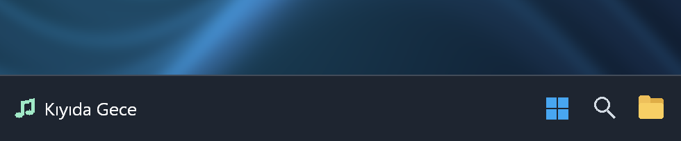
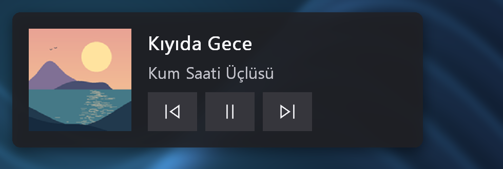

# Music Widget

[Türkçe](#türkçe) · [English](#english)

**Örnek görünüm · Sample preview**





*Şarkı, sanatçı ve kapak bu örnek için oluşturuldu. / The track, artist and artwork are fictional.*

## Türkçe

Music Widget, Windows 11 x64 görev çubuğunda bir nota simgesinin yanında Spotify veya YouTube Music’te çalan şarkının adını gösterir. Şarkı değiştiğinde, müziği duraklattığınızda veya devam ettirdiğinizde ana ekranın sol üst köşesinde dört saniyelik bir kart açılır. Kartta albüm kapağı, şarkı adı, sanatçı ve oynatıcının desteklediği düğmeler bulunur. Klavye odağı kullandığınız pencerede kalır.

### Kurulum ve kullanım

1. [Son sürümden](https://github.com/alikocidev/music-widget/releases/latest) `MusicWidget-win-x64.zip` dosyasını indirip bir klasöre çıkarın.
2. `MusicWidget.exe` dosyasını çalıştırın. Widget açıldığında zaten çalan şarkının adı görev çubuğunda görünür.
3. Spotify’da veya YouTube Music’te bir şarkı başlatın. Widget, Windows medya oturumlarını kullanarak çalan oynatıcıya geçer. İkisi aynı anda çalıyorsa Spotify önceliklidir. İkisini de duraklatırsanız son seçilen şarkı görünür kalır.

YouTube Music’i kurulu web uygulamasında veya normal bir Microsoft Edge sekmesinde kullanabilirsiniz. Windows normal sekmeyi `MSEdge` olarak tanıtır. Edge medya oturumunu başka bir sekmeye geçirirse widget o sekmedeki medyayı gösterir. Widget için ayrı bir hesap, API anahtarı veya ek çalışma zamanı gerekmez.

### Görev çubuğu ve kart ayarları

Bildirim alanındaki nota simgesine sağ tıklayın. Tercihleriniz sonraki açılışta da geçerlidir.

| Menü seçeneği | İşlevi |
| --- | --- |
| **Görev çubuğunda göster → Ana ekran / Tüm ekranlar** | Şarkı adının hangi görev çubuklarında görüneceğini seçer. Varsayılan seçim **Ana ekran**. |
| **Kartı yalnızca şarkı değiştiğinde göster** | İşaretliyken duraklatma ve devam ettirme kartı açmaz. Açık karttaki düğmeler güncellenmeye devam eder. |
| **Çıkış** | Widget’ı kapatır. |

Her ekranda başlık, Windows görev çubuğunun sol yarısındaki ilk uygun boşluğa yerleşir. Diğer ekranlarda başlığı görmek için Windows görev çubuğunun o ekranlarda da açık olması gerekir. Yer kalmadığında şarkı adını bildirim alanındaki nota simgesinin üzerine gelerek okuyabilirsiniz. Kapaklı kart her zaman ana ekranda açılır.

### Kaynaktan derleme

Arayüz Win32, medya oturumları C++/WinRT kullanır. C++20 destekli MSVC ve C++/WinRT başlıklarını içeren Windows SDK ile **Visual Studio 2022 x64 Developer PowerShell** içinde çalıştırın.

```powershell
.\build.ps1
```

Çalıştırılabilir dosya `dist/native/MusicWidget.exe` konumuna yazılır. Dağıtım paketini oluşturmak için `.\package.ps1` komutunu çalıştırın. Çıktı `dist/MusicWidget-win-x64.zip` dosyasıdır.

### Bellek ölçümü ve lisans

[C++, C# ve Wireless Battery karşılaştırması](bench/results/2026-11-19/README.md), 19 Kasım 2026 tarihli ölçümleri ve ham örnekleri içerir. Ölçümü tekrarlamak için Wireless Battery’yi açın, widget’ı ve gerçek oynatıcıları kapatın. Yukarıdaki derlemeden sonra etkileşimli Windows masaüstünde PowerShell 7 ile çalıştırın.

```powershell
.\build.ps1 -Benchmark
.\bench\measure.ps1
```

Test sessiz bir medya oturumu kullanır. Kartı test boyunca görünür bırakın. Sonuçlar `build/bench` klasörüne yazılır.

Kaynak kodu [MIT lisansı](LICENSE) ile dağıtılır.

## English

Music Widget shows the title of the current Spotify or YouTube Music track beside a music note on the Windows 11 x64 taskbar. When you change tracks, pause, or resume playback, a card appears in the upper-left corner of the primary display for four seconds. It shows the cover art, track title, artist, and playback controls supported by the player. Keyboard focus stays in your current window.

### Install and use

1. Download `MusicWidget-win-x64.zip` from the [latest release](https://github.com/alikocidev/music-widget/releases/latest) and extract it to a folder.
2. Run `MusicWidget.exe`. If a track is already playing, its title appears on the taskbar at startup.
3. Play a track in Spotify or YouTube Music. The widget follows the active player through Windows media sessions. Spotify takes priority when both are playing. If you pause both, the last selected track stays visible.

YouTube Music works as an installed web app or in a regular Microsoft Edge tab. Windows identifies the regular tab as `MSEdge`. If Edge hands its media session to another tab, the widget shows that tab’s media. The widget requires no separate account, API key, or additional runtime.

### Taskbar and card settings

Right-click the music note in the notification area. The menu uses the Turkish labels below and remembers your choices across restarts.

| Menu item | What it does |
| --- | --- |
| **Görev çubuğunda göster → Ana ekran / Tüm ekranlar** | Shows the track title on the primary display or all displays. The default is **Ana ekran** (primary display). |
| **Kartı yalnızca şarkı değiştiğinde göster** | Opens the card only on track changes. Pausing or resuming playback still updates the controls on an open card. |
| **Çıkış** | Quits the widget. |

On each display, the title uses the first available space in the left half of the Windows taskbar. To see it on additional displays, enable the Windows taskbar on those displays. If space runs out, hover over the notification-area note to read the title. The cover art card always opens on the primary display.

### Build from source

The interface uses Win32 and reads media sessions through C++/WinRT. Use **Visual Studio 2022 x64 Developer PowerShell** with a C++20-capable MSVC toolchain and a Windows SDK that includes the C++/WinRT headers.

```powershell
.\build.ps1
```

The executable is written to `dist/native/MusicWidget.exe`. To create the distribution package, run `.\package.ps1`. The output is `dist/MusicWidget-win-x64.zip`.

### Memory benchmark and license

The [benchmark report](bench/results/2026-11-19/README.md) contains the November 19, 2026 comparison of the C++ and C# versions with Wireless Battery, including the raw samples. To repeat the measurements, start Wireless Battery and close the widget and your media players. After building the widget, run the following commands in PowerShell 7 on an interactive Windows desktop.

```powershell
.\build.ps1 -Benchmark
.\bench\measure.ps1
```

The benchmark uses a silent media session. Keep the card visible during the test. Results are written to `build/bench`.

The source code is distributed under the [MIT License](LICENSE).

Developed with Codex.
